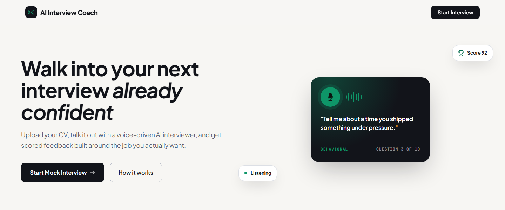
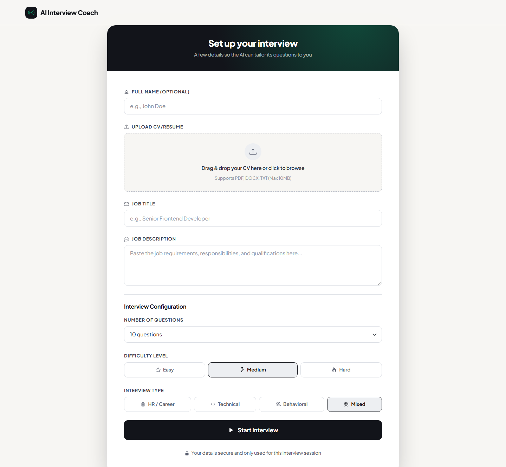
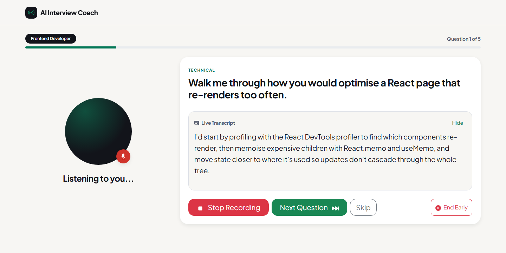
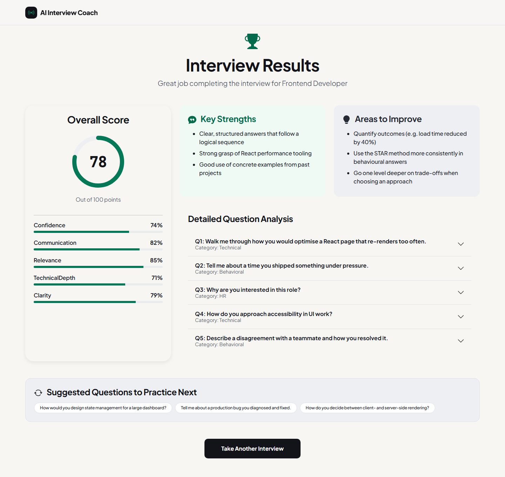
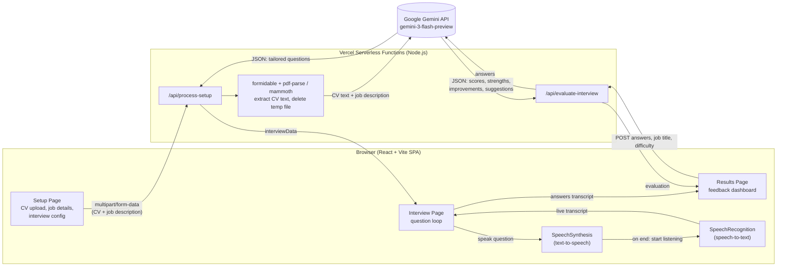

# AI Mock Interview Coach

An AI-powered interview simulator that uses the **Google Gemini API** and the **Web Speech API** to run a realistic, voice-driven mock interview. Upload your CV and a job description, answer tailored questions out loud, and get a scored evaluation of your performance.



## Key Features

- **CV and job analysis:** Upload your CV (PDF or DOCX) along with a job description. Gemini generates interview questions tailored to your experience and the role.
- **Configurable interviews:** Choose the number of questions, difficulty (Easy, Medium, Hard) and interview type (HR/Career, Technical, Behavioral, Mixed).
- **Voice-to-voice interaction:** The AI reads each question aloud, then automatically starts listening for your spoken answer.
- **Live transcript:** Your answer is converted from speech to text and shown on screen in real time.
- **AI feedback dashboard:** Get an overall score, per-category ratings (confidence, communication, relevance, technical depth, clarity), strengths, areas to improve and suggested questions to practise next.
- **Privacy first:** CVs and recordings are never stored.

---

## Screenshots

> The interview and results screens depend on live speech recognition and a Gemini API call, so these screenshots were captured from the real UI using sample interview data.

| Interview setup | Live voice interview |
| --- | --- |
|  |  |

**Feedback dashboard**



---

## System Architecture



### How it works

1. **Setup:** The user enters their name, job title and job description, uploads a CV, and picks the question count, difficulty and interview type. The form is sent to `/api/process-setup`.
2. **Question generation:** The serverless function parses the upload with `formidable`, extracts the CV text with `pdf-parse-fork` (PDF) or `mammoth` (DOCX), deletes the temporary file immediately, and asks Gemini to return a JSON array of tailored questions.
3. **Voice interview:** Entirely in the browser. `SpeechSynthesis` reads each question aloud; when it finishes, `SpeechRecognition` starts listening and streams a live transcript. Answers are collected as `{ question, answer, category }`.
4. **Evaluation:** The full transcript is sent to `/api/evaluate-interview`, where Gemini returns a JSON evaluation that is rendered as the feedback dashboard.

The Gemini API key lives only in the serverless functions and is never sent to the browser.

---

## Getting Started

### 1. Prerequisites

- **Node.js** v18 or higher
- **Gemini API key** from [Google AI Studio](https://aistudio.google.com/)
- **A Chromium-based browser** (Chrome or Edge) for speech recognition, plus microphone access

### 2. Installation

```bash
git clone https://github.com/TeekayVuyisile/AI-Mock-Interview-Coach.git
cd AI-Mock-Interview-Coach/frontend
npm install
```

### 3. Environment setup

Create a `.env` file in the `frontend` directory (see `.env.example`):

```env
VITE_GEMINI_API_KEY=your_api_key_here
```

### 4. Running locally

Run the frontend and the serverless API functions together:

```bash
npx vercel dev
```

Open [http://localhost:3000](http://localhost:3000) to start your mock interview.

> `npm run dev` starts only the Vite frontend. The UI will load, but `/api/*` calls will fail without `vercel dev`.

---

## Tech Stack

| Layer | Technology |
| --- | --- |
| Frontend | React 19, Vite, React Bootstrap, Framer Motion |
| Backend | Vercel Serverless Functions (Node.js) |
| AI | Google Gemini (`gemini-3-flash-preview`) |
| Voice | Web Speech API: SpeechRecognition (STT), SpeechSynthesis (TTS) |
| File parsing | `formidable` (uploads), `pdf-parse-fork` (PDF), `mammoth` (DOCX) |

---

## Deployment (Vercel)

1. Import the GitHub repository into [Vercel](https://vercel.com/) and set the root directory to `frontend`.
2. In **Settings > Environment Variables**, add `VITE_GEMINI_API_KEY` with your key.
3. Deploy. Vercel automatically detects the `/api` folder and serves the serverless functions.

Make sure `.env` stays in `.gitignore` so your API key is never committed.

---

## Security and Privacy

- CVs and recordings are **not** stored.
- Uploaded files are processed in memory and the temporary file is deleted immediately after text extraction.
- Speech recognition is handled by the browser's built-in Web Speech API (Chrome and Edge use their vendor's speech service); the app itself only sends the text transcript to the backend for evaluation.
- API keys are handled server-side and are never exposed to the browser.

---

Author: Teekay Vuyisile Manale
